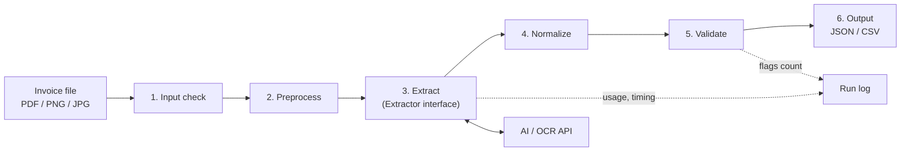
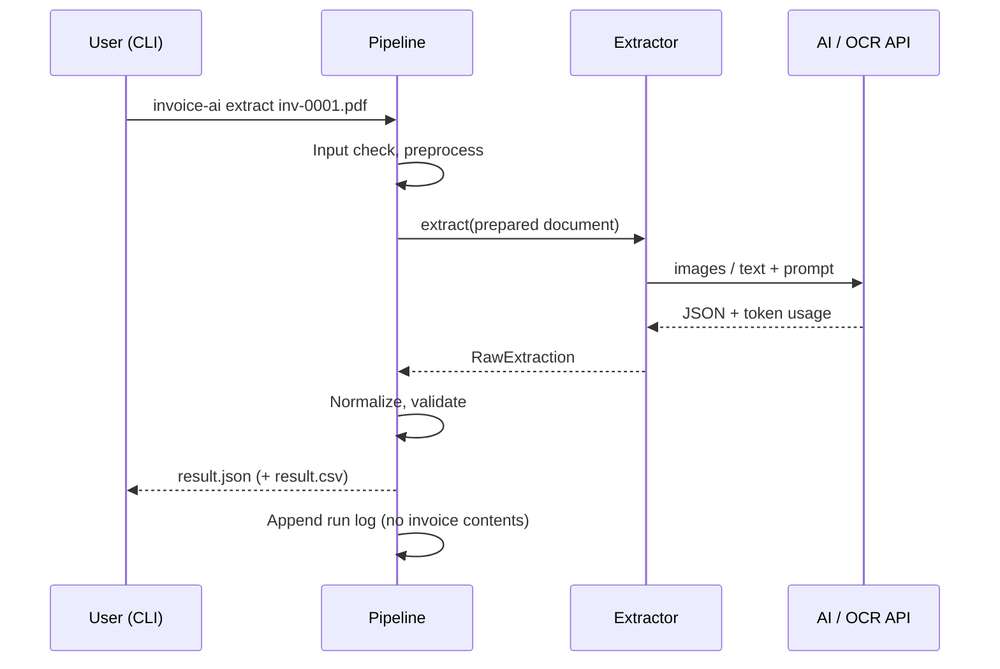
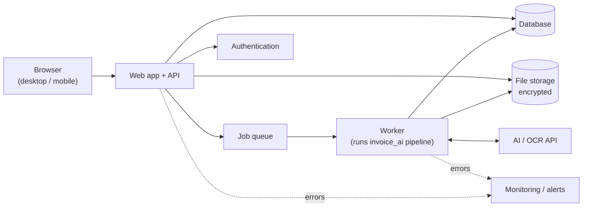

# Architecture — invoice-ai

| Item | Value |
|---|---|
| Status | Draft |
| Owner | Ibrahim |
| Last updated | 2026-11-03 |
| Related | `01-requirements.md`, `03-evaluation-plan.md`, `04-roadmap.md`, `decisions/` |

> Items marked **Proposed** are recommendations not yet confirmed. Items marked **TBD** are open and depend on the feasibility spike or later decisions. Confirmed decisions are recorded in `docs/decisions/`.

This document covers **Release 1 (extraction pipeline, CLI)** in detail and **Release 2 (web application)** at a high level. Release 2 will be designed in detail after Release 1 is complete.

## 1. Design principles

1. **The LLM reads; code decides.** The AI model only reads the invoice and returns what is printed. Normalization (dates, amounts) and validation (arithmetic, required items) are done by deterministic code that can be unit-tested.
2. **Never guess silently.** Missing or doubtful values are returned as `null` or flagged (FR-11).
3. **Swappable extraction.** The extraction step sits behind an interface so the approach or AI provider can change without touching the rest of the pipeline.
4. **Measurable.** Every run records what produced it (code version, model, prompt version) so results can be compared (`03-evaluation-plan.md`).
5. **Release 2 reuses Release 1.** The web app calls the same pipeline package; no extraction logic lives in the web layer.

## 2. Release 1 — System overview



### 2.1 Components

| # | Component | Responsibility | Requirements |
|---|---|---|---|
| 1 | Input check | Verify format (by file content, not only extension), size, page count. Reject with a clear error | FR-5 |
| 2 | Preprocess | PDF: extract text layer if present and render each page to an image. Images: fix orientation (EXIF), resize to a maximum resolution. Optional: deskew, contrast | FR-7 |
| 3 | Extract | Send page images and/or text to the extraction approach; receive raw field values **as printed** (e.g. `令和8年11月2日`, `¥10,920`) | FR-8 |
| 4 | Normalize | Convert raw values to schema types: era and Japanese dates → ISO 8601; `¥`, `円`, commas, full-width digits → decimal; NFKC for strings; currency → ISO 4217 | FR-9 |
| 5 | Validate | Arithmetic checks, required fields, date validity, registration number format, qualified-invoice item check. Produces flags; never changes values | FR-10 to FR-13 |
| 6 | Output | Write the result as JSON (schema in section 4) and optionally CSV | Release 1 scope |
| — | Run log | Record metadata per run: timing, model, prompt version, token usage, cost, errors. **No invoice contents** | FR-20 |

### 2.2 Extraction approaches

The approach is **TBD** and will be decided by the feasibility spike, using the evaluation plan.

| Approach | How it works | Expected strengths | Expected weaknesses |
|---|---|---|---|
| A. Vision LLM only | Page images go directly to a vision-capable LLM, which returns JSON | Simple; handles layout, tables, and seals visually | Cost per image; may misread small digits; harder to locate errors |
| B. OCR + LLM | An OCR engine produces text (with positions); a text LLM maps text to fields | OCR text can be inspected; possibly cheaper LLM calls | Two services to manage; OCR errors on vertical text and seals pass through |
| C. Hybrid | A + the PDF text layer or OCR text as extra context | Possibly the most accurate | Most complex and expensive |

Both A and B implement the same interface:

```python
class Extractor(Protocol):
    name: str

    def extract(self, doc: PreparedDocument) -> RawExtraction:
        """Return raw field values as printed on the invoice, plus usage info."""
```

`RawExtraction` contains raw strings per field, raw line items, and `usage` (tokens, cost, duration). The rest of the pipeline does not know which extractor was used.

### 2.3 LLM output handling

- Request **structured JSON output** using the provider's structured-output / JSON mode where available
- Validate the response against a schema; on invalid JSON, retry **once**, then mark the run as failed (no partial guessing)
- Temperature 0 (or lowest available) for consistent results
- Prompts are stored as versioned files (e.g. `prompts/extract_v1.md`); the version is recorded in each run
- Network calls use a timeout and limited retries with backoff for rate limits and temporary errors

### 2.4 Normalization rules (summary)

| Input example | Output |
|---|---|
| `令和8年11月2日` | `2026-11-02` |
| `R8.11.2`, `2026/11/02`, `2026年11月2日` | `2026-11-02` |
| `¥10,920`, `10,920円`, `１０，９２０円` | `10920` |
| `(株)サンプル` | stored as printed; compared as equal to `株式会社サンプル` in evaluation |
| `１０％`, `8%（軽減）` | `0.10`, `0.08` |

Era table: 令和 (from 2019-05-01), 平成 (1989-01-08 to 2019-04-30). Each rule has unit tests.

### 2.5 Validation rules (summary)

| Check | Rule | Flag code |
|---|---|---|
| Required fields | `vendor_name`, `invoice_number`, `invoice_date`, `currency`, `total_amount` present | `missing_required` |
| Total | `subtotal + tax_amount = total_amount` (exact for JPY) | `total_mismatch` |
| Line items | sum of `line_items.amount` = `subtotal` (or total, for tax-inclusive invoices) | `line_items_mismatch` |
| Tax per rate | `taxable_amount × rate ≈ tax_amount` within ±1 yen | `tax_rate_mismatch` |
| Dates | valid date; `due_date` ≥ `invoice_date` | `invalid_date` |
| Registration number | matches `^T\d{13}$` | `invalid_registration_number` |
| Qualified invoice | required items present (FR-12) | reported in `qualified_invoice.missing_items` |

## 3. Data flow for one invoice



## 4. Output schema

Defined in code as Pydantic models (`src/invoice_ai/schema.py`); a JSON Schema file is generated from them. The evaluation labels (`03-evaluation-plan.md`) use the same `fields` structure.

```json
{
  "schema_version": "1.0",
  "source_file": "inv-0001.pdf",
  "fields": {
    "vendor_name": "株式会社サンプル商事",
    "vendor_registration_number": "T1234567890123",
    "recipient_name": "山田太郎",
    "invoice_number": "INV-2026-0042",
    "invoice_date": "2026-11-02",
    "due_date": "2026-11-30",
    "currency": "JPY",
    "subtotal": 10000,
    "tax_amount": 920,
    "tax_breakdown": [
      {"rate": 0.10, "taxable_amount": 6000, "tax_amount": 600},
      {"rate": 0.08, "taxable_amount": 4000, "tax_amount": 320}
    ],
    "total_amount": 10920,
    "line_items": [
      {"description": "コピー用紙", "quantity": 2, "unit_price": 3000, "amount": 6000, "tax_rate": 0.10},
      {"description": "お茶 ※", "quantity": 10, "unit_price": 400, "amount": 4000, "tax_rate": 0.08}
    ]
  },
  "flags": [
    {"field": "due_date", "code": "missing_optional", "message": "Due date not found on the invoice"}
  ],
  "qualified_invoice": {
    "missing_items": []
  },
  "meta": {
    "extractor": "vision_llm",
    "model": "TBD",
    "prompt_version": "extract_v1",
    "duration_ms": 8400,
    "cost_jpy": 3.2
  }
}
```

Rules:
- Amounts: JPY as integers; other currencies as decimal strings with 2 places (avoids floating-point errors)
- Unknown or missing values: `null`, never an empty string or a guess
- `schema_version` changes whenever the structure changes

## 5. Technology stack

| Area | Choice | Status | Reason |
|---|---|---|---|
| Language | Python 3.12+ | **Proposed** | Strongest ecosystem for AI/LLM, PDF, and OCR work; matches the project's learning goal |
| Schema / validation | Pydantic v2 | **Proposed** | Typed models, JSON Schema generation, validation of LLM output |
| CLI | Typer | **Proposed** | Simple, typed CLI |
| PDF text | pdfplumber | **Proposed** | Text layer extraction; MIT license |
| PDF → image | pypdfium2 | **Proposed** | Fast rendering; permissive license. PyMuPDF is avoided because it is AGPL-licensed, which would impose AGPL terms on anyone distributing or hosting the combined software, against the intent of this MIT-licensed project |
| Image handling | Pillow | **Proposed** | Orientation, resize |
| AI provider / model | **TBD** | Spike | Compare 1–2 vision-capable LLM APIs on the dev set |
| OCR engine (approach B) | **TBD** | Spike | Candidates: a cloud OCR service, or an open-source engine with Japanese support |
| Settings and secrets | `.env` + pydantic-settings | **Proposed** | API keys never in code or Git (NFR-6) |
| Tests | pytest | **Proposed** | Unit tests for normalization and validation |
| Packaging / environment | uv (or pip + venv) | **Proposed** | Reproducible setup (NFR-11) |
| Lint / format | Ruff | **Proposed** | One fast tool for both |

Check license and current versions of each library when adding it.

## 6. Repository structure

```
invoice-ai/
├── README.md
├── LICENSE
├── pyproject.toml
├── .env.example                # placeholder keys only
├── .gitignore                  # .env, data/, eval/results/, .DS_Store
├── docs/
│   ├── 01-requirements.md
│   ├── 02-architecture.md
│   ├── 03-evaluation-plan.md
│   ├── 04-roadmap.md
│   ├── decisions/
│   └── diagrams/
├── src/invoice_ai/
│   ├── cli.py                  # Typer entry point
│   ├── pipeline.py             # Orchestrates steps 1–6
│   ├── schema.py               # Pydantic models (output + raw extraction)
│   ├── config.py               # Settings from environment
│   ├── input_check.py
│   ├── preprocess.py
│   ├── extractors/
│   │   ├── base.py             # Extractor protocol
│   │   ├── vision_llm.py       # Approach A
│   │   └── ocr_llm.py          # Approach B
│   ├── prompts/
│   │   └── extract_v1.md
│   ├── normalize/
│   │   ├── dates.py
│   │   ├── amounts.py
│   │   └── text.py
│   ├── validate/
│   │   ├── arithmetic.py
│   │   ├── fields.py
│   │   └── qualified_invoice.py
│   ├── output.py               # JSON / CSV writers
│   └── runlog.py
├── eval/
│   ├── run.py                  # Evaluation entry point
│   ├── compare.py              # Comparison rules
│   └── report.py
├── tests/
└── data/                       # git-ignored: invoices, labels, metadata, split
```

## 7. Cross-cutting concerns

| Concern | Approach |
|---|---|
| Secrets | `.env` (git-ignored); `.env.example` committed with placeholders |
| Privacy | Logs and run records never contain invoice text or images; `data/` is git-ignored |
| Errors | Each step raises typed errors; the CLI shows a clear message and exits with a non-zero code. One failed invoice does not stop a batch |
| Cost control | Token usage and cost recorded per run; optional per-run cost limit for evaluation batches |
| Reproducibility | Run records include git commit, model, prompt version, and settings |
| Testing | Unit tests for normalize and validate (no API calls); extractor tests use recorded responses; real API calls only in evaluation runs |

## 8. Release 2 — High-level architecture

Detailed design follows after Release 1.



| Area | Notes | Status |
|---|---|---|
| Processing | Upload returns immediately; a background worker runs the pipeline; the UI shows status (FR-6) | Planned |
| Web framework | Options: FastAPI (same language as the pipeline) or Laravel (existing experience) calling the pipeline as a separate service | **TBD** |
| Database | PostgreSQL (or MySQL) | **TBD** |
| File storage | Object storage with encryption at rest (NFR-6) | **TBD** |
| Authentication | Build in-house or use an auth provider | **TBD** (open question in requirements) |
| Hosting | Provider and region; affects APPI handling (NFR-7) | **TBD** |
| i18n | All UI text in translation files (NFR-12) | Planned |

## 9. Decisions to record

| ADR | Decision | Status |
|---|---|---|
| 0001 | Python as the pipeline language | Proposed |
| 0002 | LLM reads; deterministic code normalizes and validates | Proposed |
| 0003 | Extraction approach (A / B / C) and AI provider | Pending spike |
| 0004 | PDF libraries (pdfplumber + pypdfium2, avoid AGPL) | Proposed |
| 0005 | Release 2 web framework | Pending |

## 10. Open questions

- Which extraction approach and provider, based on spike results?
- Is the PDF text layer reliable enough to use as extra context (approach C)?
- How should multi-page invoices be sent: all pages in one request, or page by page and merged?
- Release 2 web framework: FastAPI or Laravel?
