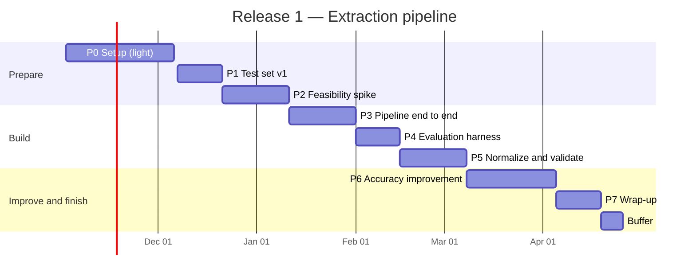

# Roadmap — invoice-ai

| Item | Value |
|---|---|
| Status | Draft |
| Owner | Ibrahim |
| Last updated | 2026-11-03 |
| Related | `01-requirements.md`, `02-architecture.md`, `03-evaluation-plan.md` |

## 1. Overview

| Release | Period | Effort |
|---|---|---|
| Release 1 — Extraction pipeline (CLI) | 2026-12-07 – 2027-04-25 (20 weeks) | 6–8 hours/week, about 140 hours planned |
| Release 2 — Web application | **TBD**, after Release 1 | **TBD** |

Capacity: 20 weeks × 6–8 hours = 120–160 hours. The plan uses about 140 hours, including one buffer week. Holidays (year-end, Golden Week) are assumed to have reduced time.

Phases are done **in order**. Each phase ends with a clear "done when" check. Detailed tasks live in GitHub Issues, grouped by a GitHub Milestone per phase.

## 2. Release 1 timeline

## 3. Phases

### P0 — Setup (now – 2026-12-06, light, ~4 h)

| Task | |
|---|---|
| Requirements, architecture, evaluation plan, roadmap drafts | ☑ |
| `.gitignore`, `.env.example`, starter README | ☑ |
| First commit and push | ☑ |
| Create GitHub Milestones P1–P7 and first issues | ☐ |

**Done when:** docs and repo basics are committed and pushed.

### P1 — Test set v1 (2026-12-07 – 2026-12-20, ~14 h)

| Task | |
|---|---|
| Choose how to create synthetic invoices (templates, tool) | ☐ |
| Create or collect 20 invoices covering the main cases in `03-evaluation-plan.md` §3.2 | ☐ |
| Label them (JSON per invoice) and check each label twice | ☐ |
| Fill `metadata.csv` and fix the dev/test split | ☐ |

**Done when:** 20 labeled invoices exist in `data/` with metadata and a fixed split.

### P2 — Feasibility spike (2026-12-21 – 2027-01-10, ~16 h, includes year-end break)

| Task | |
|---|---|
| Throwaway scripts: approach A (vision LLM) on 10 dev invoices | ☐ |
| Same for approach B (OCR + LLM) | ☐ |
| Compare accuracy on key fields, cost, and time (by hand or a small script) | ☐ |
| Record decision in `docs/decisions/0003-extraction-approach.md` | ☐ |
| Confirm or change the stack in `02-architecture.md` §5 (ADR 0001, 0004) | ☐ |

**Done when:** one approach and provider are chosen, with numbers to justify it.

### P3 — Pipeline end to end (2027-01-11 – 2027-01-31, ~21 h)

| Task | |
|---|---|
| Project setup: `pyproject.toml`, uv, Ruff, pytest | ☐ |
| `schema.py`: Pydantic models for raw extraction and output | ☐ |
| Input check and preprocessing (PDF text + render, image orientation) | ☐ |
| Extractor for the chosen approach, with structured JSON output and retry | ☐ |
| CLI: `invoice-ai extract <file>` writes JSON | ☐ |
| Run log (no invoice contents) | ☐ |

**Done when:** one command turns any dev-set invoice into a JSON file, even if values are inaccurate.

### P4 — Evaluation harness (2027-02-01 – 2027-02-14, ~14 h)

| Task | |
|---|---|
| `eval/compare.py`: comparison rules (`03-evaluation-plan.md` §5.2) | ☐ |
| `eval/run.py`: run pipeline on a split, produce `summary.md`, `details.csv`, `run.json` | ☐ |
| Slicing by metadata | ☐ |
| Record the **baseline** on the dev set | ☐ |

**Done when:** one command produces an accuracy report, and the baseline is recorded.

### P5 — Normalize and validate (2027-02-15 – 2027-03-07, ~21 h)

| Task | |
|---|---|
| Normalization: era/Japanese dates, amounts (¥, 円, commas, full-width), NFKC, tax rates — with unit tests | ☐ |
| Validation: required fields, totals, line items, tax per rate, dates, registration number — with unit tests | ☐ |
| Qualified-invoice item check (FR-12) | ☐ |
| Flag metrics in the evaluation report (`03-evaluation-plan.md` §5.4) | ☐ |

**Done when:** all rules have passing unit tests and flags appear in output and in the evaluation report.

### P6 — Accuracy improvement (2027-03-08 – 2027-04-04, ~28 h)

| Task | |
|---|---|
| Grow the test set to about 40 invoices, focusing on failed cases | ☐ |
| Improve prompts, preprocessing, multi-page handling — one change at a time | ☐ |
| Record significant changes in `docs/decisions/` | ☐ |
| Set final targets for NFR-1 to NFR-4 | ☐ |
| Run the held-out test set once at the end of the phase | ☐ |

**Done when:** targets are met on the held-out set, or the gap is measured and explained.

### P7 — Wrap-up (2027-04-05 – 2027-04-18, ~14 h)

| Task | |
|---|---|
| CSV output | ☐ |
| Error handling for batches (one failure does not stop the rest) | ☐ |
| README: setup, usage, how to run the evaluation | ☐ |
| Final held-out evaluation; results in `docs/evaluation-results.md` | ☐ |
| Short final report: results, lessons learned, next steps | ☐ |
| Tag `v1.0.0` | ☐ |

**Done when:** all Release 1 success criteria (`01-requirements.md` §10.1) are met.

### Buffer (2027-04-19 – 2027-04-25, ~7 h)

Absorbs delays from earlier phases. If unused, start Release 2 planning.

## 4. Rules for staying on track

- **Weekly check (10 minutes):** update task checkboxes and GitHub issues; note hours spent
- **If a phase slips by more than one week:** cut scope instead of extending the deadline. Candidates to cut first:
  1. Approach C (hybrid) experiments
  2. CSV output (JSON only)
  3. Foreign-currency invoices
  4. Growing the test set beyond 30 invoices
- **No new features during Release 1.** New ideas go to section 6 ("Later")
- **Update this roadmap** when reality changes, and note why in the change log below

## 5. Release 2 — outline (not scheduled)

Planned after Release 1. Order to be confirmed:

1. Release 2 design (update `02-architecture.md` §8; framework decision, ADR 0005)
2. Accounts and authentication
3. Upload, background processing, status
4. Review and correction screen
5. History, deletion, export
6. Hosting, monitoring, backups
7. Privacy policy and terms (APPI)
8. User testing with a few small business owners or freelancers

## 6. Later (ideas, not planned)

- Japanese UI
- Registration number verification against the National Tax Agency registry
- Storage compliant with 電子帳簿保存法
- Accounting software integration
- Other countries and languages

## 7. Change log

| Date | Change | Reason |
|---|---|---|
| 2026-11-02 | First draft | — |
| 2026-11-03 | P0: repo basics done | Consistency fixes across docs before first commit |
